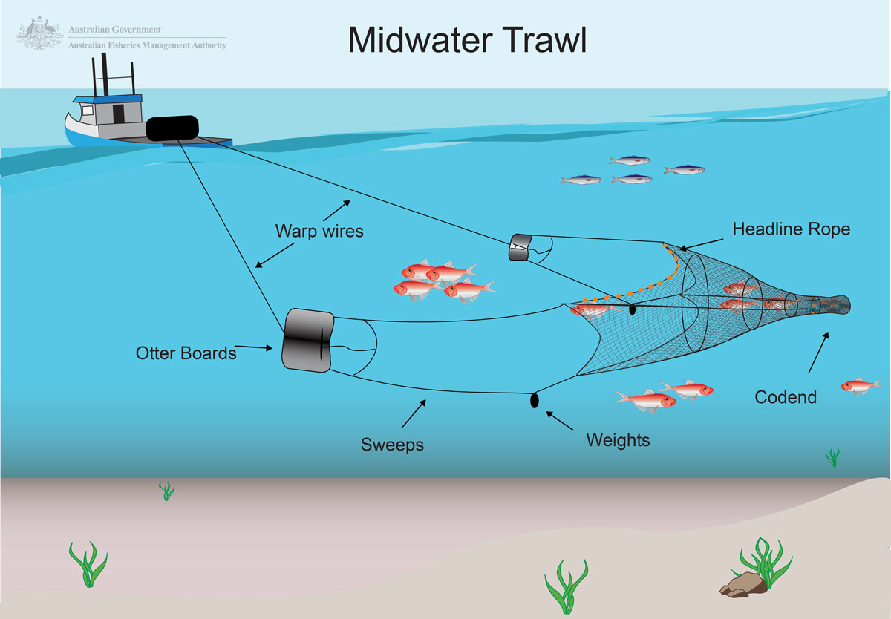

```{r}
require(tidyverse)
```

## [Introduction]{style="background: #4a1035ff; color: #bebe56ff"}

- Estimating fish stock abundance is important for sustainable fisheries management.
- Various methods exist, each with strengths and limitations.
- Choice of method depends on species, habitat, data availability, and resources.

## [Fish abundance]{style="background: #4a1035ff; color: #bebe56ff"}

- Fish abundance refers to the number of individuals in a fish population within a defined area.
- It is a key metric for assessing the health and sustainability of fish stocks.
- Accurate abundance estimates inform management decisions, such as setting catch limits and conservation measures.
- Abundance can be expressed as:

    - **Absolute abundance** -- Measure the actual number of fish in an area i.e Pond
    - **Relative abundance** -- Estimate the number of fish at a given locality

## [Fish abundance...]{style="background: #4a1035ff; color: #bebe56ff"}
 
- Abundance is not a fixed quantity -- Varies from time to time (seasonal) due to;

  - **Internal forces** i.e births and deaths and 
  - **External forces** i.e seasonal availability of food, changes in environmental conditions that may affect the population
  
- It varies from place to place because of the heterogeneity of the environment 

## [Fish abundance...]{style="background: #4a1035ff; color: #bebe56ff"}

- Within the area of distribution the abundance of a population always vary -- either grow (increase) or decline

- The population may vary with season due to;

  - Births
  - Deaths  
  - Seasonal migration (spawning, feeding and over-wintering) recruitment

## [Fish migration]{style="background: #4a1035ff; color: #bebe56ff"}

- Fish migration is mass relocation by fish from one area or body of water to another.
- Fish migrate;

  - On a regular basis   
  - On time scales -- from daily, seasonal, annually or   
  - Longer, and over distances -- from a few metres to thousands of kilometres. 
- Such migrations are usually done for feeding or to reproduce, but in other cases the reasons are unclear.
- Migration affects local abundance estimates and must be considered in survey design.


## [Fish migration...]{style="background: #4a1035ff; color: #bebe56ff"}

```{mermaid}

flowchart LR
  A(Spawning </br> Ground) --> B(Feeding </br> Ground)
  B --> C(Wintering </br> Ground)
  C --> A
  B --> A
  A --> C
  C --> B


```

## [Terminologies in fish migration]{style="background: #4a1035ff; color: #bebe56ff"}

- **Diadromous** -- Fishes that migrate between the sea and freshwater.
- **Anadromous** -- Diadromous fishes which spend most of their lives in the sea and migrate to freshwater to breed (salmon, sea trout, shad, sea lampreys, sturgeons)
- **Catadromous** -- Diadromous fishes which spend most of their lives in freshwater and migrate to the sea to breed (eel, Salangidae, Galaxidae, Retropinnidae).
- **Amphidromous** -- Diadromous fishes which migrate from the sea to freshwater or vice versa, but not for the purpose of breeding (some Exocidae,Perca fluviatilis, some Mugilidae).


## [Terminologies in fish migration...]{style="background: #4a1035ff; color: #bebe56ff"}

- **Potamodromous** --  Migratory fishes that live and migrate wholly within freshwater systems (rivers, lakes, streams). They never enter marine environments e.g (trout, bream, Coregonoids)

    - Complete their entire life cycle in freshwater. 
    - Migrate between different freshwater habitats for spawning, feeding, or overwintering

- Their migration patterns are triggered by Water temperature changes, Flooding (access to floodplain habitats), Photoperiod (day length), Food availability, Spawning readiness

## [Terminologies in fish migration...]{style="background: #4a1035ff; color: #bebe56ff"}

- **Oceanodromous** -- Migratory fishes that live and migrate wholly within the sea (marine environment). They never enter freshwater. (cod, herring, capelin, tuna, mackerel).
- Complete their entire life cycle in marine waters
- Migrate between different ocean habitats for spawning, feeding, or seasonal movements
- Migration distances can range from coastal movements to trans-oceanic journeys (thousands of kilometers)
- Their migration patterns are triggered by Sea surface temperature gradients, Ocean current patterns (monsoons in Indian Ocean), Prey availability (following zooplankton blooms), Spawning readiness and lunar cycles, Upwelling events

## [Methods for estimating fish abundance]{style="background: #4a1035ff; color: #bebe56ff"}

**1. Direct Methods (Surveys)**

- Trawl surveys, acoustic surveys, visual surveys
- Provide absolute or relative abundance estimates
- Require dedicated research vessels and equipment

**2. Indirect Methods (Fishery-Dependent)**

- CPUE, mark-recapture, depletion methods
- Use commercial fishery data
- Cost-effective but subject to biases

**3. Statistical Models**

- Virtual Population Analysis, integrated models
- Combine multiple data sources
- Require specialized software and expertise

## [1. Trawl Surveys--Swept area method]{style="background: #4a1035ff; color: #bebe56ff"}

- It is assumed that the area swept by the trawl is representative for the entire area over which the fishes are distributed.
- That fish caught within the area swept by the trawl net is proportion to their abundance

## [Trawl net]{style="background: #4a1035ff; color: #bebe56ff"}

::: {.columns}
::: {.column width="60%"}
- Trawl net is a conical bag with a wide mouth fitted with otter boards for horizontal opening and floats and weights for vertical opening.
- This net sweeps the sea bed over a wide area. 
- The tail end of the gear where the fishes are collected is called **codend**.
:::
::: {.column width="40%"}

{width="100%"}
:::
::: 

## [Types of Trawl Nets]{style="background: #4a1035ff; color: #bebe56ff"}

- Trawl nets that are dragged on the sea floor are called **bottom trawls**.
- **Bottom trawl** - Demersal species (snappers, groupers, flatfish)
- **Mid-water trawl** - Pelagic species (sardines, herring)

## [Swept area method]{style="background: #4a1035ff; color: #bebe56ff"}

**Principle of swept area method:**

- The mean catch (either in weight or in numbers) per unit of effort or per unit of area is an index of the stock abundance.
- This index is converted into an absolute measure of biomass.

## [Swept area method...]{style="background: #4a1035ff; color: #bebe56ff"}

$$\frac{a}{A} = \frac{c}{B}$$ 

- The biomass (B) is converted to absolute biomass by multiplying with constant R

$$\frac{a}{A}=\frac{c}{BR}$$


## [Swept area method...]{style="background: #4a1035ff; color: #bebe56ff"}

$$B = \frac{cA}{aR}$$

Where; 

B = Biomass

a = area swept by the net

c = catch

A = area of distribution of the fish stock

R = retention rate of the net (0.5 - 0.8)

## [Swept area method...]{style="background: #4a1035ff; color: #bebe56ff"}

- A trawl net is used to estimate the mean catch at a number of stations in a fish stock
- A towed trawl net samples fish in an area (a) prescribed by the net's effective width and distance traveled by the net


## [Calculations on swept area method]{style="background: #4a1035ff; color: #bebe56ff"}

- Let 

  **a** be the area prescribed by the net
  **h** is the length of the net head rope
  
  If the effective width of the net (w) is proportion to the head rope (e.g 0.6);
  
  Then,
  
  $w = 0.6h$
  

## [Swept area method...]{style="background: #4a1035ff; color: #bebe56ff"}

- If the towing speed (v) and time for trawling (t) is known then, it is possible to calculate the distance (d) covered during towing 

$$d = v\times t$$

- Then, the area prescribed by the net during towing is 
$$a = w \times d$$
 $$a = w\times v\times t$$

## [Question 1]{style="background: #4a1035ff; color: #bebe56ff"}


After 0.5 hour of trawling at a speed of 2 km per hour, 3 tons of fish were caught by a trawl net with a head rope measuring 20m. If the retention rate of the net was 50% and only 0.6 of the head rope was making an effective width of the path, calculate the biomass of a fish stock of *Solea solea* distributed over an area of 4 km^2^

## [Solution]{style="background: #4a1035ff; color: #bebe56ff"}

$$\frac{a}{A} = \frac{c}{BR}$$ 
$$B = \frac{cA}{aR}$$ 

## [Solution]{style="background: #4a1035ff; color: #bebe56ff"}

t = 0.5hr

v = 2km/hr

c = 3tons

h = 20m = 0.02km

R = 50% = 0.5

w = 0.6h = 0.6*0.02

A = 4 km2

B = ?

## [Solution...]{style="background: #4a1035ff; color: #bebe56ff"}

$$B = \frac{3tons\times 4km2}{0.6\times0.02km\times2km/hr\times0.5hr\times0.5}$$


$$B = 2000tons$$

---

*Last updated: January 2026*
