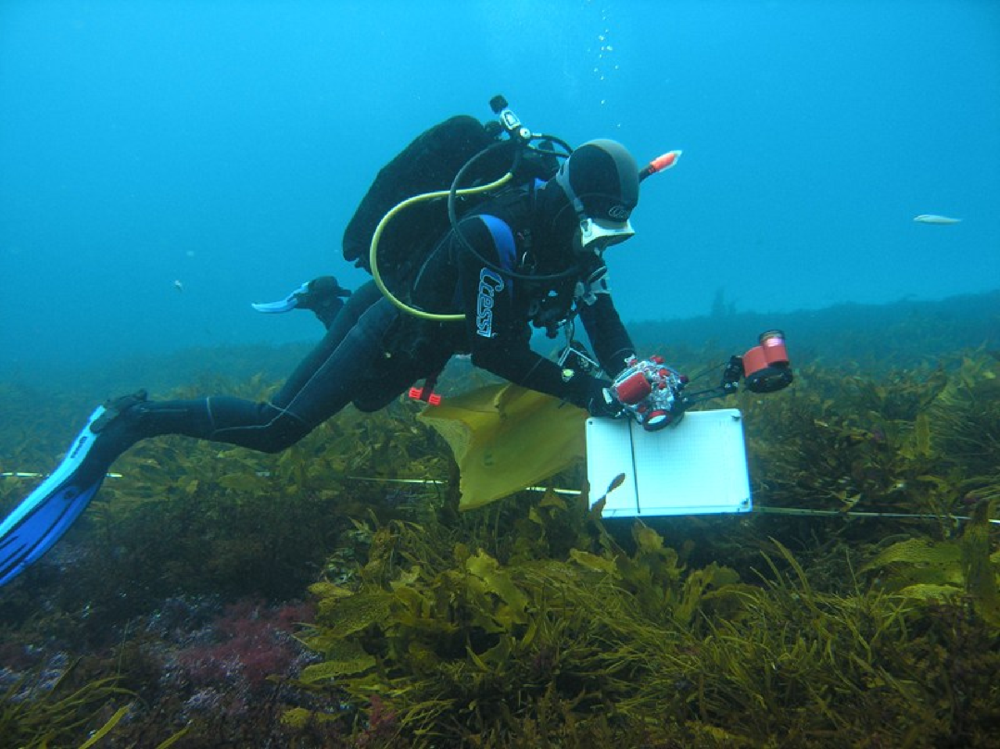

```{r}
require(tidyverse)
```

## [2. Acoustic Surveys]{style="background: #4a1035ff; color: #bebe56ff"}

+ The hydroacoustic survey uses an echo sounder to conduct acoustic biomass estimation.
+ It is widely used for assessing pelagic fish stocks (e.g., sardines, anchovies, herring, mackerel, tuna).


## [2. Acoustic Surveys]{style="background: #4a1035ff; color: #bebe56ff"}

+ In practice for fish stock assessment, acoustic surveys are used to estimate fish stock.
+ These surveys are used to estimate the abundance of fish species that form schools in the water column.
+ They are particularly useful for pelagic species that are difficult to sample with traditional trawl surveys.

## [Acoustic Surveys: Key Terms]{style="background: #4a1035ff; color: #bebe56ff"}

+ **Acoustic survey** - A survey that uses acoustic sound to estimate fish stock.
+ **Echo sounder** - A device that uses sound waves to detect fish.
+ **Echo** - A sound wave that is reflected back to the sounder.
+ **Hydroacoustic survey** - A survey that uses hydroacoustic sound to estimate fish stock.
+ **Hydroacoustic** means using sound in water.

## [Acoustic survey methodology]{style="background: #4a1035ff; color: #bebe56ff"}

- An acoustic transducer emits a brief, focused pulse of sound into the water.
- If the sound encounters objects that are of different density than the surrounding medium, such as fish, they reflect some sound back toward the source. 
- The time it takes for the echo to return is used to calculate the distance to the object.

## [Acoustic survey methodology...]{style="background: #4a1035ff; color: #bebe56ff"}

- These echoes provide information on fish size, location, and abundance. 
- The basic components of the scientific echo sounder hardware function is to transmit the sound, receive, filter and amplify, record, and analyze the echoes. 
- While there are many manufacturers of commercially available **fish-finders**, quantitative analysis requires that measurements be made with calibrated echo sounder equipment, having high signal-to-noise ratios.

## [Principle of echo sounding]{style="background: #4a1035ff; color: #bebe56ff"}

- Everything scattered in the water column reflects sound waves depending on the frequency of the waves. 
- The higher frequency the shorter the wave length.
- Therefore frequencies **> 200 KHz**  can produce echo from **plankton**.
- For fishes, a  lower frequency  **< 200 KHz** is used

## [Conditions for echo sounding]{style="background: #4a1035ff; color: #bebe56ff"}

- Suitable for small pelagic fish stocks (big pelagic fishes eg. Tuna swim very fast and therefore the method becomes unsuitable).
- The behavior of the fish to be assessed must be known 

  - e.g the distribution of the fish in the water column at different times 
  - The reaction of the fish towards the fishing boat should also be taken into account.

- The use of a smaller boat towed by the bigger vessel to carry the transducer helps to detect fish which are frightened by the vessel.

## [Limitations of echo sounders]{style="background: #4a1035ff; color: #bebe56ff"}

- Sound beam interference by sound scatters eg. temperature stratification, air bubbles, sediments, debris, vegetation
- Unsuitable for very shallow depths because of the blind zone that exists a few meters  below the transducer depending on the diameter of the transducer and the frequency of the sound waves. 

  - The larger the diameter the larger the zone.
  - Very deep waters  calls for a stronger pulse generating  echo sounder


## [3. Underwater Visual Census Survey (UVCS)]{style="background: #4a1035ff; color: #bebe56ff"}

- The more traditional method in which diver count fish along transects
- It involves an observer, equipped with SCUBA gear, estimating the abundance of fish within a given area (the belt transect).
- A multitude of factors, including fish mobility and habitat complexity, have been shown to effect the precision of the counting technique. 

## [Applications of UVCS]{style="background: #4a1035ff; color: #bebe56ff"}

::: {.columns}
::: {.column}

**Best suited for:**

    - Reef fish communities
    - Shallow coastal waters
    - Clear water environments
    - Surface schooling species (tuna, sardines)
:::
::: {.column}
{width=300px}
:::
::: 

## [Underwater Methods]{style="background: #4a1035ff; color: #bebe56ff"}

::: {.columns}
::: {.column}

**Belt Transect Method:**

+ Diver swims along fixed transect (e.g., 50 m × 5 m)
+ Records all fish within belt width
+ Estimates size classes
+ Multiple transects per site
:::
::: {.column}
**Point Count Method:**

+ Diver remains stationary
+ Counts fish within cylinder (e.g., 7.5 m radius)
+ Records species, size, abundance
+ Less affected by fish flight behavior

:::
:::


## [Advantages & disadvantages of UVCS]{style="background: #4a1035ff; color: #bebe56ff"}

::: {.columns}
::: {.column}
**Advantages:**

- Direct observation
- Species identification possible
- Behavioral information
- Relatively low cost
- Good for complex habitats (reefs)
:::
::: {.column}
**Disadvantages:**

- Limited to clear, shallow water
- Weather and visibility dependent
- Observer bias
- Diver safety concerns
- Small spatial coverage
- Fish behavior affects counts
:::
:::

## [4. Catch per unit effort (CPUE)]{style="background: #4a1035ff; color: #bebe56ff"}

- CPUE is catch obtained per standardized unit of fishing effort
- Used as an **index of abundance** (relative, not absolute)
- Catch rate (CPUE) is frequently and single most useful index for long-term monitoring of a fishery

## [4. Catch per unit effort (CPUE)...]{style="background: #4a1035ff; color: #bebe56ff"}

**Formula:**

$$\text{CPUE} = \frac{\text{Total Catch}}{\text{Total Effort}}$$

**Effort units:**

- Fishing hours or days at sea
- Number of hooks (longline)
- Number of fishers
- Number of vessels
- Number of gears

## [4. Catch per unit effort (CPUE)...]{style="background: #4a1035ff; color: #bebe56ff"}

- Changes in CPUE may give an indication of what is happening to the fish stock size 
- In theory, a constant trend of CPUE values represents a stable stock
- A rising trend indicates an increasing stock 
- Increases in CPUE may mean that a fish stock is recovering and more fishing effort can be applied.

## [4. Catch per unit effort (CPUE)...]{style="background: #4a1035ff; color: #bebe56ff"}

- A falling trend signifies a declining stock
- A declines in CPUE may mean that the fish population cannot support the level of harvesting.
- However, a falling trend does not necessarily indicate overfishing;

  - A fish stock will always decline from its initial high level when fishing occurs until it reaches an equilibrium level, when productivity balances the catch being taken.

- CPUE can therefore be used as an index of stock abundance 


## [Advantages & disadvantages of CPUE]{style="background: #4a1035ff; color: #bebe56ff"}

**Advantages:**

- Uses existing commercial data
- Cost-effective
- Long time series available in many areas
- Large spatial coverage
- Real-time updates possible

## [Advantages & disadvantages of CPUE]{style="background: #4a1035ff; color: #bebe56ff"}

**Disadvantages:**

- Differences regarding interpretation of fishing effort
- Changes in actual or effective effort as a result of technological development
- Also influenced by skills, experience
- Affected by fisher behavior
- May not reflect true abundance
- Reporting biases
- It is also difficult to know what factors of the fishing operations are important to measure
- It is difficult to keep up with fishery changes

  eg. CPUE could be altered without it being reflected on the stock size

    - A boat may install a more powerful motor    
    - Or change from day to night fishing. 
- Not useful for measuring changes in the stock size of schooling fish species

  - eg. a pelagic species which schools at the surface can be easily seen from fishing boats or spotter planes  therefore can be caught in bulk by purse seine nets.
  

## [5. Mark-Recapture Methods]{style="background: #4a1035ff; color: #bebe56ff"}

- Is a Relative Fish abundance estimation 
- It involves capturing, marking, release and recapturing
- The basic concept is that;
  - *The ratio of recaptures in the second sample is equivalent to the proportion of those that were marked during the first sampling occasion to the whole population*. 
  
## [5. Mark-Recapture Methods...]{style="background: #4a1035ff; color: #bebe56ff"}

- Then, estimation of population size (N) will be;

$$
\frac{m_2}{n_2} = \frac{n_1}{N}
$$
  

- Sample 1 -- marked and released	

  - $n_1$ = number captured and marked on the 1st sampling occasion
  
- Sample 2 - number of recaptures recorded

  - $n_2$ = number captured on the second sampling 	occasion
  - $m_2$ = number of recaptures on the second occasion


## [Assumptions for mark recapture method]{style="background: #4a1035ff; color: #bebe56ff"}

- The population is closed so that N remains constant 

   - i.e. there is no movement in or out  by birth, death, immigration or recruitment
   
- All the fish have the same probability of being caught
- Marked and unmarked fish have equal capture probability
- The second sample is a random sample of the population
- No marks of fish are lost between the sampling occasions
- No marks go unrecorded during the second sampling
- Marks do not affect survival

## [Advantages & disadvantages of Mark-Recapture]{style="background: #4a1035ff; color: #bebe56ff"}

::: {.columns}
::: {.column}
**Advantages:**

- Direct abundance estimate
- Provides movement information
- Estimates survival rates
- Useful for discrete populations
:::
::: {.column}
**Disadvantages:**

- Tagging stress and mortality
- Tag loss or shedding
- Expensive and labor-intensive
- Assumption violations is common
- Limited to feasible population sizes
:::
:::


## [Mark-Recapture: Example 1]{style="background: #4a1035ff; color: #bebe56ff"}

**Problem:**

500 tilapia are captured, marked, and released in Lake Victoria. One week later, 200 fish are recaptured, of these, 25 have marks. Find the population estimate in the lake.

## [Solution]{style="background: #4a1035ff; color: #bebe56ff"}

Using the mark-recapture formula:

$$\frac{m_2}{n_2} = \frac{n_1}{N}$$

Where:

- $n_1 = 500$ (marked fish released)
- $n_2 = 200$ (fish recaptured)
- $m_2 = 25$ (marked fish recaptured)
- $N$ = ??? (unknown population size)

Rearranging the formula to solve for $N$:
$$N = \frac{n_1 \times n_2}{m_2}$$
Substituting the values:
$$N = \frac{500 \times 200}{25} = 4000$$

The estimated population size of tilapia in Lake Victoria is **4000** fishes.

## [Mark-Recapture: Example 2]{style="background: #4a1035ff; color: #bebe56ff"}

In a capture-recapture process, 200 fishes were tagged. From the capture results, the game warden estimates that, the lake contains 2500 fishes. What percentage of fishes were tagged?


## [Solution]{style="background: #4a1035ff; color: #bebe56ff"}

Let p be the percent of tagged fishes;

 $$
 \frac{n_1}{N} = \frac{p}{100}
 $$

 $\frac{200}{2500}=\frac{p}{100}$
 
 $p = 8\%$
 
- About $8\%$ of fishes were tagged


## [6. Depletion Methods]{style="background: #4a1035ff; color: #bebe56ff"}

- This method is mainly used for shell fish fishery i.e Octopus
- The method uses either of the two models i.e **Leslie** and **DeLury** methods which depend upon the following assumptions;
- Fishing (or sampling) must take a significant proportion of the population causing a depletion 

## [6. Depletion method...]{style="background: #4a1035ff; color: #bebe56ff"}


- The decrease in catch per unit effort is proportional to;

  - The reduction in the population  
  - Catchability of fish remains constant  
  - Units of effort (or fishing gear) do not compete with one another - remains the same  
  - The entire population is available to the fishery  
  - There is no recruitment, natural mortality, immigration or emigration in the population. 

## [6. Depletion method...]{style="background: #4a1035ff; color: #bebe56ff"}

- It involves the removal of individuals from a stock and measuring the resulting decrease in relative abundance using CPUE as an abundance index.
- It involves fishing on a closed population in which there is no immigration and emigration
- Time interval is short enough to ignore losses due to natural mortality.

## [6. Depletion method...]{style="background: #4a1035ff; color: #bebe56ff"}

**Leslie Method:**

$$
\frac{C_t}{f_t} = q(N_o - IC)
$$ {#eq-eqn1}

Where;

- $C_t$ = number of fish caught at time t
- $f_t$ = effort expended in taking $C_t$
- $\frac{C_t}{f_t}$ = catch per unit effort at time t (CPUE)
- $N_o$ = initial population size
- $q$ = catchability
- $IC$ = accumulated catch

## [6. Depletion method...]{style="background: #4a1035ff; color: #bebe56ff"}

Or the **Leslie** formula can be expressed as;

$$
C_t = qN_0 - q\sum_{i=1}^{t-1}C_i
$$ {#eq-eqn2}

Where:

- $C_t$ = Catch in period $t$
- $q$ = Catchability coefficient
- $N_0$ = Initial population size
- $\sum_{i=1}^{t-1}C_i$ = Cumulative catch up to time $t-1$

- Then, plot $C_t$ vs. cumulative catch; y-intercept = $qN_0$, slope = $-q$

## [Leslie Method: Octopus Example]{style="background: #4a1035ff; color: #bebe56ff"}

```{r}
#| echo: true
#| 
# Octopus depletion study data (Tanzanian coastal fishery)
octopus_data <- tibble(
  period = 1:10,
  effort = c(50, 55, 60, 65, 70, 75, 80, 85, 90, 95),
  days = rep(5, times = 10),
  catch = c(585, 552, 517, 483, 448, 412, 375, 338, 299, 258),
  cumulative_catch = cumsum(catch),
  cpue = catch / (effort * days)
)

# **Results:**

# - **Initial Population ($N_0$):** ~8,267 octopus
# - **Catchability ($q$):** 0.0138
# - **Total Depletion:** 4,267 individuals (52% of stock)

```

## [Leslie Data Table]{style="background: #4a1035ff; color: #bebe56ff"}

```{r}
octopus_data |>
  select(effort, days, catch, cumulative_catch, cpue) |>
  knitr::kable(
    digits = c(0, 0, 0, 0, 3),
    col.names = c("Effort (traps)", "days", "Catch", "Cumulative Catch", "CPUE")
  )
```

## [Leslie Method: Octopus Example...]{style="background: #4a1035ff; color: #bebe56ff"}

```{r}
#| include: true
#| echo: true
#| 
# Fit linear regression: Catch vs Cumulative Catch
leslie_model <- lm(catch ~ cumulative_catch, data = octopus_data)
N0_estimate <- coef(leslie_model)[1]
q_estimate <- -coef(leslie_model)[2]

# intercept = coef(leslie_model)[1]
# q = coef(leslie_model)[2] #slope
# from C_t = qN0 - q*IC
# intercept = qN0
# therefore N0 = intercept/q

```

## [Leslie graph]{style="background: #4a1035ff; color: #bebe56ff"}

```{r}
# Plot
ggplot(octopus_data, aes(x = cumulative_catch, y = catch)) +
  geom_point(size = 3, color = "#f6773cff") +
  geom_smooth(method = "lm", se = FALSE, color = "#bebe56ff", linewidth = 1) +
  ggpubr::stat_regline_equation(color = "#bebe56ff") +
  geom_hline(yintercept = 0, linetype = "dashed", color = "red") +
  geom_vline(xintercept = 0, linetype = "dashed", color = "red") +
  labs(
    title = "Leslie Depletion Method: Octopus Fishery",
    x = "Cumulative Catch (individuals)",
    y = "Catch in Period (individuals)",
    subtitle = paste0("N₀ = ", round(N0_estimate), " (intercept), q = ", round(q_estimate, 4))
  ) +
  theme_minimal()  +
  theme(
    plot.background = element_rect(fill = "#4a1035ff", color = NA),
    panel.background = element_rect(fill = "#4a1035ff", color = NA),
    text = element_text(color = "#bebe56ff", size = 12),
    axis.text = element_text(color = "#bebe56ff"),
    plot.title = element_text(color = "#f6773cff", size = 14, face = "bold"),
    plot.subtitle = element_text(color = "#bebe56ff", size = 11)
  )
  
```

```{r}
#| eval: false
#| 
# Fit linear regression: Catch vs CPUE
leslie_model_cpue <- lm(catch ~ cpue, data = octopus_data)
N0_estimate_cpue <- coef(leslie_model_cpue)[1]
q_estimate_cpue <- coef(leslie_model_cpue)[2]

```

```{r}
#| eval: false
#| 
# Plot
ggplot(octopus_data, aes(x = cpue, y = catch)) +
  geom_point(size = 3, color = "#f6773cff") +
  geom_smooth(method = "lm", se = FALSE, color = "#bebe56ff", linewidth = 1) +
  ggpubr::stat_regline_equation(color = "#bebe56ff") +
  # geom_hline(yintercept = 0, linetype = "dashed", color = "red") +
  # geom_vline(xintercept = 0, linetype = "dashed", color = "red") +
  labs(
    title = "Leslie Depletion Method: Octopus Fishery",
    x = "CPUE",
    y = "Catch in Period (individuals)",
    subtitle = paste0("N₀ = ", round(N0_estimate_cpue), " (intercept), q = ", round(q_estimate_cpue, 0))
  ) +
  theme_minimal()  +
  theme(
    plot.background = element_rect(fill = "#4a1035ff", color = NA),
    panel.background = element_rect(fill = "#4a1035ff", color = NA),
    text = element_text(color = "#bebe56ff", size = 12),
    axis.text = element_text(color = "#bebe56ff"),
    plot.title = element_text(color = "#f6773cff", size = 14, face = "bold"),
    plot.subtitle = element_text(color = "#bebe56ff", size = 11)
  )
  
```


## [Advantages & disadvantages of depletion methods]{style="background: #4a1035ff; color: #bebe56ff"}

::: {.columns}
::: {.column}
**Advantages:**

- Simple data requirements
- Uses commercial fishing data
- Provides absolute estimate
- Quick results
:::
::: {.column}
**Disadvantages:**

- Requires closed population
- Needs significant depletion
- Assumes constant catchability
- Not suitable for mobile species
- Short-term application only
:::
:::

## [7. Pelagic Egg and Larval Surveys]{style="background: #4a1035ff; color: #bebe56ff"}

**Principle:**

- Sample ichthyoplankton (fish eggs and larvae)
- Estimate spawning stock biomass from egg production

## [7. Pelagic Egg and Larval Surveys..]{style="background: #4a1035ff; color: #bebe56ff"}

**Daily Egg Production Method (DEPM):**

$$SSB = \frac{P_0 \times A}{R \times S \times F}$$

Where:

- $SSB$ = Spawning stock biomass
- $P_0$ = Daily egg production per unit area
- $A$ = Spawning area
- $R$ = Sex ratio (proportion female)
- $S$ = Spawning fraction (proportion spawning per day)
- $F$ = Batch fecundity (eggs per spawning female)

## [Parameter interpretation]{style="background: #4a1035ff; color: #bebe56ff"}


**$P_0$ (Daily Egg Production)**: Measures spawning intensity in the survey area. Higher $P_0$ indicates active spawning; reflects reproductive output per unit spawning habitat.

**$A$ (Spawning Area)**: Geographic extent of the spawning ground. Larger area = greater total egg production. Accurate delineation is critical.

**$R$ (Sex Ratio)**: Only females produce eggs. Must adjust for proportion of females in spawning population.

**$S$ (Spawning Fraction)**: Not all females spawn on a given day. Varies by species and environmental conditions. Lower $S$ = smaller daily fraction of stock spawning.

**$F$ (Batch Fecundity)**: Individual female reproductive capacity. Higher $F$ = fewer females needed to produce observed eggs. Critical parameter often determined from histological analysis.


## [Sample question 1:]{style="background: #4a1035ff; color: #bebe56ff"}


A sardine spawning survey in Tanzanian coastal waters collected the following data:

- Daily egg production per unit area ($P_0$) = 450 eggs/m²/day
- Spawning area ($A$) = 5,000 km²
- Sex ratio ($R$) = 0.52 (52% female)
- Spawning fraction ($S$) = 0.35 (35% spawn per day)
- Batch fecundity ($F$) = 12,000 eggs/female

Calculate the spawning stock biomass (SSB) of sardine given that each sardine egg weighs ~0.75 mg.

## [Answer:]{style="background: #4a1035ff; color: #bebe56ff"}


First, convert spawning area to m²:
$$A = 5,000 \text{ km}^2 = 5,000 \times 10^6 \text{ m}^2 = 5 \times 10^9 \text{ m}^2$$

Apply DEPM formula:
$$SSB = \frac{450 \times 5 \times 10^9}{0.52 \times 0.35 \times 12,000}$$

$$SSB = \frac{2.25 \times 10^{12}}{2,184} = 1.03 \times 10^9 \text{ eggs}$$

Converting to biomass (sardine eggs ~0.75 mg = 0.00075 g per egg):
$$1.03 \times 10^9 \text{ eggs} \times 0.00075 \text{ g/egg} = 7.73 \times 10^8 \text{ g}$$

Convert to tonnes (1 tonne = $10^6$ g):
$$\frac{7.73 \times 10^8 \text{ g}}{10^6 \text{ g/tonne}} = 773 \text{ tonnes}$$

$$SSB \approx 773 \text{ tonnes}$$


## [Applications Egg/Larval Surveys]{style="background: #4a1035ff; color: #bebe56ff"}

**Best suited for:**

- Species with pelagic eggs (sardines, anchovies, cod)
- Spawning aggregations
- When adult surveys are difficult

**Requirements:**

- Knowledge of spawning season and area
- Fecundity estimates
- Egg development rates (temperature-dependent)
- Egg mortality rates


## [Choosing the right method]{style="background: #4a1035ff; color: #bebe56ff"}

**Consider:**

1. **Species characteristics** - Habitat, behavior, life history
2. **Data availability** - What data already exists?
3. **Resources** - Budget, equipment, expertise
4. **Management needs** - Precision required, time frame
5. **Stock status** - Data-rich vs. data-limited

**Best Practice:**

- Use **multiple methods** when possible
- Cross-validate results
- Account for uncertainty in all estimates

# [Details of choosing the right method]{style="background: #4a1035ff; color: #bebe56ff"}

## Species Characteristics

**Habitat and Distribution**

- **Pelagic species** (schooling in water column) → Acoustic surveys or CPUE effective
- **Demersal species** (bottom-dwelling) → Trawl surveys or visual census better
- **Reef or complex habitat** → Underwater visual census preferred
- **Migratory species** → Mark-recapture or telemetry useful

## Behavior and Biology

- **Schooling tendency** → Acoustic surveys or visual methods work well
- **Cryptic or nocturnal** → Trawl or acoustic surveys needed
- **High fecundity (pelagic eggs)** → Egg/larval surveys applicable


## Existing Data Infrastructure

- **Long CPUE time series** → Use as abundance index; standardize for technical advances
- **Landing records** → Base for catch assessment; allows trend analysis
- **Port sampling history** → Enables biological composition; supports age-structured models
- **Frame survey data** → Provides raising factors; critical for extrapolation
- **Observer programs** → Use for bycatch, discards, spatial data

## Data Gaps and Quality

- **Poor data quality** → Favor robust, simple methods
- **Missing biological samples** → Rely on proxy indicators or external data
- **Incomplete spatial coverage** → Use stratified surveys to fill gaps


## [Details: Resources and Capacity]{style="background: #4a1035ff; color: #bebe56ff"}

**Budget Constraints**

- **Limited funds** → CPUE, mark-recapture (low cost)
- **Moderate budget** → Portside sampling + CPUE standardization
- **Adequate budget** → Combine multiple independent methods

**Technical Expertise and Equipment**

- **Experienced staff** → Complex statistical models, acoustic calibration
- **Limited expertise** → Simple, standardized protocols (belt transects, trawls)
- **Vessel availability** → Surveys feasible; without → landing-site data
- **Specialized gear** → Echo sounders enable acoustic/larval surveys


## [Details: Management Objectives]{style="background: #4a1035ff; color: #bebe56ff"}

**Precision and Timeliness**

- **Real-time monitoring** → VMS, landing-site observers, CPUE trends
- **High-precision estimates** → Acoustic surveys, depletion methods
- **Annual assessment** → CPUE, frame survey sufficient
- **Catch limit compliance** → Real-time landing monitors

**Spatial and Temporal Resolution**

- **Fine spatial detail** → Demersal surveys, underwater visual census
- **Broad geographic coverage** → Acoustic, CPUE
- **Seasonal patterns important** → Multiple surveys per year
- **Single stock estimate** → Annual frame + catch survey


## [Details: Stock Status]{style="background: #4a1035ff; color: #bebe56ff"}

**Data-Rich Fisheries (10+ years of data)**

- Multiple data sources available
- Fit stock-recruitment models; use abundance indices
- Sophisticated age-structured assessment possible
- Approach: Cross-validate multiple methods

**Data-Limited Fisheries**

- Few or recent observations
- Simple methods: length-based estimates, catch trends
- Rely on CPUE, frame survey, fisher interviews
- Approach: Conservative reference points; focus on monitoring trends


## [Details: Cost-Benefit and Feasibility]{style="background: #4a1035ff; color: #bebe56ff"}

**Cost per Estimate and Coverage**

| Method | Cost | Coverage | Speed |
|--------|------|----------|-------|
| Acoustic | Very high | Large area | Fast |
| Trawl survey | High | Medium area | Moderate |
| CPUE | Very low | Fleet-wide | Real-time |
| Portside sampling | Moderate | Landing-based | Regular |
| Depletion | Low | Confined | Quick |
| Visual census | Moderate | Local | Slow |

**Logistical Constraints**

- **Weather windows** → Acoustic, research surveys require calm seas
- **Accessibility** → Remote sites difficult; landing-site methods preferred
- **Safety concerns** → Divers limited by depth; alternatives needed


## [Method Selection Decision Tree]{style="background: #4a1035ff; color: #bebe56ff"}

**Key Questions to Guide Choice:**

1. **Can I dedicate a research vessel and crew?**
   - YES → Acoustic, trawl, or demersal surveys
   - NO → CPUE, mark-recapture, portside sampling

2. **Is long-term CPUE data available and reliable?**
   - YES → Standardize and use as abundance index
   - NO → Initiate frame survey + catch sampling

3. **Are multiple independent data sources available?**
   - YES → Integrate in model; cross-validate
   - NO → Use simplest appropriate method

4. **What precision is required for management?**
   - High → Combine multiple methods; narrow confidence intervals
   - Moderate → Single well-designed survey
   - Low → Trends sufficient; prioritize cost-effectiveness


## [Best Practice Summary]{style="background: #4a1035ff; color: #bebe56ff"}

**Systematic Approach (Six Factors):**

1. **Species characteristics** - Habitat, behavior, life history
2. **Data availability** - Existing data? Quality? Critical gaps?
3. **Resources** - Budget, equipment, expertise, vessel time
4. **Management needs** - Precision, time frame, spatial/temporal resolution
5. **Stock status** - Data-rich vs. data-limited
6. **Feasibility** - Logistics, safety, access, season windows

**Key Principles:**

- Use **multiple methods** when possible to cross-validate results
- Start simple; invest in better methods as capacity and funding grow
- Prioritize data filling critical gaps in abundance understanding
- Document all assumptions and uncertainties explicitly
- Combine quick-turnaround methods (CPUE) with rigorous, slower surveys
- Never overstate precision; always quantify uncertainty in estimates


## [Summary]{style="background: #4a1035ff; color: #bebe56ff"}

- No single method is perfect for all situations
- **Direct methods** (surveys) provide independent estimates but are costly
- **Indirect methods** (CPUE, depletion) use existing data but have biases
- **Statistical models** integrate multiple sources for best estimates
- Choice depends on species, data, resources, and management needs
- **Multiple methods** increase confidence in abundance estimates

---

*Last updated: February 2026*
